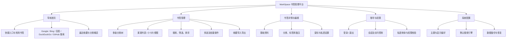
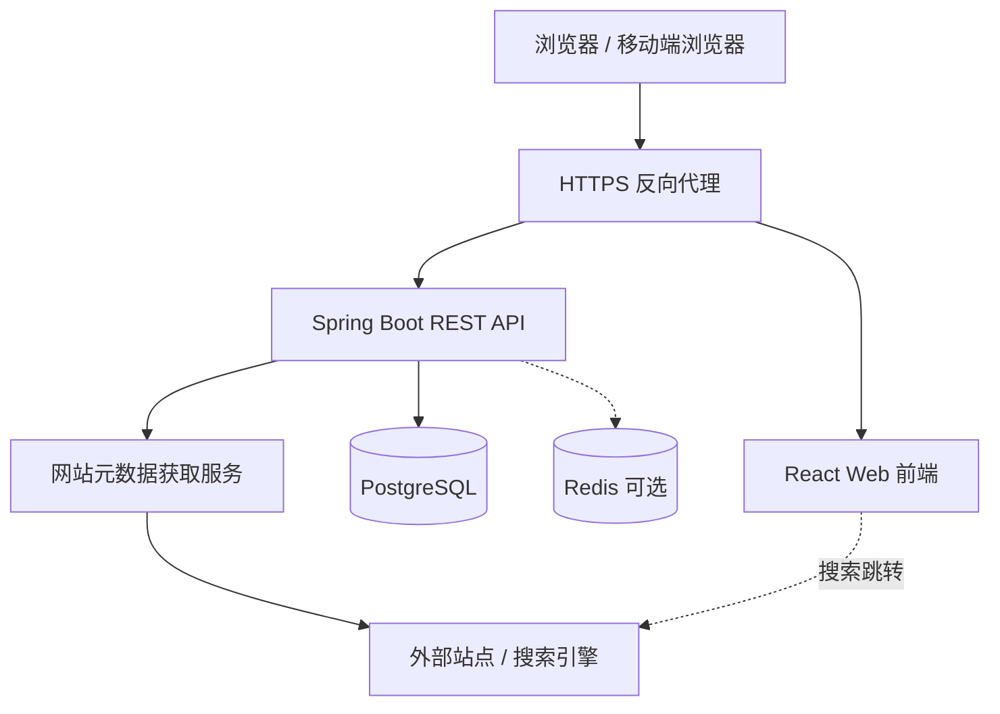
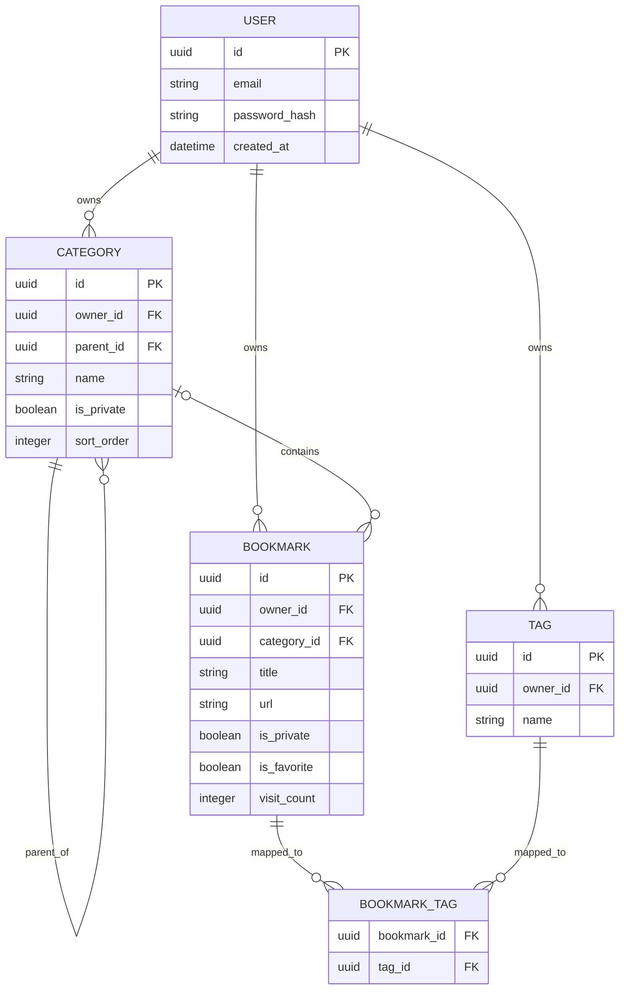

# MarkSpace 书签管理平台建设方案

> **文档版本：** V1.0  
> **编制日期：** 2026-10-30  
> **配套原型：** MarkSpace V3（三页面交互式原型）  
> **文档用途：** 产品需求确认、UI/交互设计、前后端开发、测试验收及后续迭代依据  
> **状态：** 建议方案（未确认项在文末列出）

---

## 1. 项目概述

### 1.1 建设背景

浏览器自带书签适合简单收藏，但在网址数量持续增长后，容易出现分类层级混乱、查找不便、批量整理效率低、首页访问路径长等问题。现有部分书签管理产品侧重视觉化大卡片，信息密度偏低；部分网址导航产品则缺乏完整的书签管理和权限控制能力。

MarkSpace 拟建设为**集网址导航、书签归档、分类管理、快速搜索与私密管理于一体的轻量级个人书签平台**。核心策略是：**一个系统、三类页面、统一数据、按登录状态控制可见性**。

### 1.2 产品定位

- **产品名称：** MarkSpace
- **产品类型：** Web 端个人书签管理与导航平台
- **目标用户：** 需要收藏、整理和高频访问大量网址的个人用户，尤其适合开发、设计、学习与知识管理场景
- **部署方式：** 优先支持自部署；正式版本支持服务器数据库持久化及多设备访问
- **交互风格：** 简洁、紧凑、低干扰，兼顾桌面端使用效率与移动端响应式体验

### 1.3 建设目标

| 目标 | 具体要求 | 验收方向 |
|---|---|---|
| 高效导航 | 首页可直接访问常用网站，支持多个搜索引擎 | 从首页完成网址跳转与外部搜索 |
| 高密度管理 | 默认紧凑列表，减少封面卡片浪费的空间 | 单屏展示较多书签，仍可快速辨识 |
| 层级整理 | 支持多级分类，分类可展开、折叠、调整父级 | 可创建三级及以上分类并正确筛选 |
| 登录即用 | 登录后私密书签与普通书签完整融合展示 | 无单独私密空间、无二次解锁 |
| 批量整理 | 支持多选、批量移动、标签、星标、隐私属性、导出与删除 | 批量操作正确且结果可验证 |
| 可持续扩展 | 前后端分离、数据结构清晰 | 可扩展数据导入、同步与浏览器扩展 |

### 1.4 设计原则

1. **以查找与整理效率为第一优先级**，不采用占据大面积空间的封面卡片作为默认视图。
2. **私密是一种访问权限，不是另一套独立书签空间。** 登录即按用户权限展示，无需输入第二个密码。
3. **分类与书签共用一套权限规则。** 私密分类中的所有后代分类与书签自动受保护。
4. **所有批量操作必须可预览影响范围、可明确确认结果。** 危险操作优先支持撤销或回收站。
5. **原型与生产系统严格区分。** 原型本地存储不等同于生产级账号认证、数据隔离或备份能力。

---

## 2. 用户角色和权限范围

### 2.1 初期角色

| 角色 | 登录要求 | 使用范围 |
|---|---|---|
| 访客 | 无需登录 | 查看允许公开访问的导航内容及普通书签；使用首页搜索 |
| 已登录用户（所有者） | 需要登录 | 查看本人全部书签与分类，包含私密内容；新增、编辑、批量管理和导出 |
| 系统管理员（后续可选） | 需要管理权限 | 管理账号与系统配置；**不因管理员身份而默认具有访问其他用户私密内容的产品权限** |

> **一期推荐边界：** 先按“单所有者 + 访客只读”的部署方式实现。普通内容可被访客查看，私密内容必须登录所有者账号才可查看。未来如支持多用户，需增加租户/用户归属和公开发布规则，**不能将“非私密”自动理解为向全网公开**。

### 2.2 可见性矩阵

| 内容/操作 | 访客 | 已登录的内容所有者 |
|---|---|---|
| 普通分类 | 可见（符合公开范围时） | 可见 |
| 普通书签 | 可见（符合公开范围时） | 可见 |
| 私密分类及其子分类 | 不可见 | 在同一棵分类树正常显示 |
| 私密书签 | 不可见 | 在同一列表正常显示 |
| 标题、URL、标签、备注的搜索 | 仅公开范围 | 包含本人全部私密与普通内容 |
| 新增、修改、删除与批量操作 | 不允许 | 允许 |
| 修改隐私属性 | 不允许 | 允许，并遵守继承规则 |

---

## 3. 功能架构与信息架构

### 3.1 功能架构



### 3.2 一级导航

| 入口 | 对应页面 | 作用 |
|---|---|---|
| 导航首页 | `/home` | 高频访问、快捷搜索、常用站点 |
| 全部书签 | `/bookmarks` | 管理和查找所有有权限查看的书签 |
| 星标收藏 | `/bookmarks?filter=starred` | 聚合常用、重要站点 |
| 多级分类 | `/bookmarks?categoryId=...` | 按分类及其子分类组织书签 |
| 书签新增/编辑 | `/bookmarks/new`、`/bookmarks/:id/edit` | 维护书签资料 |
| 账号与设置 | `/settings`（弹层亦可） | 账号、主题、导入导出与偏好配置 |

> 页面路径为正式版**建议路由**；V3 交互原型使用 `#/home`、`#/library`、`#/new`、`#/edit/:id`。

---

## 4. 页面一：导航首页

### 4.1 页面目标

让用户打开平台后能够**直接搜索、直接访问常用网站、快速找到最近收藏**，并在不进入管理页的情况下完成日常访问。

### 4.2 布局建议

```text
┌────────────────────────────────────────────────────────────────┐
│ 左侧导航 │ 顶部：搜索 / 新建书签 / 主题 / 登录状态             │
│          ├─────────────────────────────────────────────────────┤
│ 导航首页 │  欢迎区 / 轻量统计                                  │
│ 全部书签 │  [ Google ][ Bing ][ 百度 ][ DuckDuckGo ][ GitHub ] │
│ 星标收藏 │  [              输入关键词并搜索               ↵ ] │
│          │                                                     │
│ 分类树   │  常用网站  [图标 网站名] [图标 网站名] ...          │
│          │  最近收藏  [紧凑网站项] [紧凑网站项] ...           │
└────────────────────────────────────────────────────────────────┘
```

### 4.3 搜索引擎

| 搜索源 | 范围 | 建议搜索入口 |
|---|---|---|
| Google | 通用网页搜索 | `https://www.google.com/search?q={keyword}` |
| Bing | 通用网页搜索 | `https://www.bing.com/search?q={keyword}` |
| 百度 | 中文网页搜索 | `https://www.baidu.com/s?wd={keyword}` |
| DuckDuckGo | 通用网页搜索 | `https://duckduckgo.com/?q={keyword}` |
| GitHub | 默认搜索仓库 | `https://github.com/search?q={keyword}&type=repositories` |

**交互要求：**

- 搜索框上方用轻量切换标签选择引擎；记住上次选择结果。
- 输入关键词按 Enter 或点击搜索按钮，默认在新标签页打开结果。
- 查询词必须进行 URL 编码；只允许预定义、可信的搜索链接模板。
- GitHub 初期默认按仓库搜索；后续可扩展“仓库 / 代码 / Issues / 用户”类型。
- 未登录也可以使用外部搜索；对平台内部私密书签的检索仍需登录。

### 4.4 导航与快捷访问

- **常用网站：** 默认根据用户星标及访问频次显示，后续可支持手动置顶、排序和固定分组。
- **最近收藏：** 展示最近新增或更新的书签，可一键跳转。
- **分类概览：** 展示分类数量或收藏数量，不必采用大面积数据统计图。
- **权限行为：** 登录用户可以在快捷区域看到本人私密书签；访客不得获得其标题、网址、图标来源、分类名称等信息。

---

## 5. 页面二：书签管理

### 5.1 页面目标

面向书签较多的场景，以**信息密度、层级导航、批量管理**为核心，兼顾较少书签时的易用性。

### 5.2 结构布局

```text
┌──────────────────┬─────────────────────────────────────────────────────┐
│ 多级分类树        │ 全部书签                         [+ 新建书签]     │
│                  │ [搜索标题/域名/标签/备注]  [筛选] [排序] [视图]     │
│ ▾ 开发工具        │ ☐  标题和域名       分类      标签     星标  操作  │
│   ▾ 后端开发      │ ☐  Spring Boot      Java      后端      ☆    ···   │
│     ▸ Java       │ ☐  PostgreSQL       数据库    工具      ★    ···   │
│   ▸ 前端开发      │ ☐  GitHub           开发工具  代码      ★    ···   │
│ ▾ 设计资源        │ ☐  Figma            设计资源  UI        ☆    ···   │
│ 🔒 个人收藏       │                                                     │
│                  │  已选择 4 项  [移动] [标签] [星标] [私密] [导出] [删]│
└──────────────────┴─────────────────────────────────────────────────────┘
```

### 5.3 分类树能力

| 编号 | 功能 | 需求说明 | 优先级 |
|---|---|---|---|
| CAT-01 | 多级分类 | 父子层级不限于两级，满足递归目录组织 | P0 |
| CAT-02 | 展开 / 折叠 | 保存用户展开状态；首次可只展开根层 | P0 |
| CAT-03 | 新建 / 重命名 | 可在指定父级下创建子分类 | P0 |
| CAT-04 | 调整父级 | 禁止将分类移入自身或其后代，防止循环 | P0 |
| CAT-05 | 删除分类 | 默认要求分类无子分类、无书签才能删除 | P0 |
| CAT-06 | 分类筛选 | 选择父分类后，默认展示其所有子孙分类的书签 | P0 |
| CAT-07 | 私密属性 | 分类可单独标为私密，并向下继承 | P0 |
| CAT-08 | 分类排序 | 支持排序字段，后续增加拖拽排序 | P1 |
| CAT-09 | 分类数量 | 建议展示包含子分类的书签总数 | P1 |

### 5.4 书签展示方式

**默认模式：紧凑列表。** 每条书签建议占 **44–52 px** 高度，展示：选择框、favicon、标题、域名、所属分类、主要标签、星标与更多操作；标题、域名超长时省略并提供完整悬浮信息。

**备选模式：紧凑卡片。** 不使用大封面图，显示图标、标题、域名及必要标签；桌面端按容器宽度自适应排列。用户切换视图后记住偏好。

**视图通用规则：**

- 单击标题或图标打开原网站；操作按钮不应误触发跳转。
- 私密项目用小锁标识，但不改变其在列表中的正常位置。
- 鼠标悬停提供常用操作；键盘用户能够访问相同功能。
- 对上千条数据使用服务端分页或虚拟列表，防止页面卡顿。

### 5.5 搜索、过滤与排序

- **全局搜索：** 标题、URL、域名、简介、标签、备注、分类名称。
- **条件组合：** 当前分类及其后代 + 搜索词 + 星标/私密属性 + 标签筛选。
- **排序：** 最新添加、最早添加、名称、访问次数；正式版可追加最近访问、手动排序。
- **私密可见性：** 同一个搜索输入框即可检索全部有权限的内容，不单独设置私密搜索入口。
- **URL 去重提醒：** 新建或批量导入时提示相同或规范化后相同的网址（P1）。

### 5.6 批量操作

| 编号 | 功能 | 行为及限制 | 优先级 |
|---|---|---|---|
| BATCH-01 | 多选 / 全选 | 行复选框、全选当前结果、取消选择 | P0 |
| BATCH-02 | 批量移动 | 将选中书签移动到指定分类，自动重新计算继承私密状态 | P0 |
| BATCH-03 | 批量修改标签 | 添加、移除、替换三种模式 | P0 |
| BATCH-04 | 批量星标 | 添加星标；正式版建议同时支持取消星标 | P0 |
| BATCH-05 | 批量私密设置 | 设为私密/普通；禁止违背父分类私密继承规则 | P0 |
| BATCH-06 | 批量导出 | 导出选中书签为 JSON；含私密内容需明确提示 | P0 |
| BATCH-07 | 批量删除 | 展示数量、二次确认；正式版建议软删除及回收站 | P0 |
| BATCH-08 | 跨页选择 | 当前页全选与“选择全部符合筛选条件的 N 项”明确区分 | P1 |

**建议交互流程：** 选择书签 → 底部/顶部浮动工具栏展示已选数量 → 选择操作 → 涉及隐私或破坏性修改时确认 → 后端提交 → 返回成功/失败数 → 更新列表与分类计数。

**一致性要求：** 对小规模批量操作优先使用数据库事务，保证全成功或全失败；对大规模异步任务需展示任务进度，并对部分失败提供逐条报告。操作前再次校验全部 ID 是否属于当前用户且有权限修改，不能信任前端传来的 ID。

---

## 6. 页面三：书签详情与编辑

### 6.1 页面用途

同一套表单完成新增、查看与修改；编辑与新增使用统一的数据验证规则，避免信息不一致。

### 6.2 字段设计

| 字段 | 类型 | 必填 | 设计要求 |
|---|---|---|---|
| 标题 | 字符串 | 是 | 建议不超过 200 字符 |
| URL | 字符串 | 是 | 仅允许 `http`/`https`；服务端做合法性校验 |
| 简介 | 文本 | 否 | 用于快速识别收藏内容 |
| 所属分类 | 分类 ID | 否 | 可为空，表示未分类；只能选择当前用户有权使用的分类 |
| 标签 | 多个字符串 | 否 | 支持多个标签、去重及长度限制 |
| 备注 | 文本 | 否 | 支持用户自行记录用途、账号相关提示等；不建议存放密码 |
| 星标 | 布尔值 | 否 | 是否进入常用/星标收藏 |
| 私密 | 布尔值 | 否 | 与分类继承规则共同计算最终可见性 |
| 网站图标 | URL/图标资源 | 否 | 自动获取，失败时以首字母占位 |
| 创建/更新时间 | 时间戳 | 系统 | 由后端维护 |
| 最近访问/次数 | 时间/整数 | 系统 | 为常用书签排序提供基础数据 |

### 6.3 交互设计

- 从书签列表点击编辑，进入表单；保存后保留在编辑页并反馈保存成功。
- 新增时可粘贴 URL，尝试获取网页标题与图标；获取失败不影响手动保存。
- 右侧可显示紧凑版实时预览；窄屏时放在表单下方或收起。
- 若选择私密父分类，书签最终状态自动变为私密，不能通过单独关闭书签私密开关绕过。
- 从私密分类移到普通分类时，应计算书签本身的私密标志是否仍生效，并提示可能发生的可见性变化。
- 删除需要确认；正式版可通过回收站恢复。

---

## 7. 私密分类与私密书签的业务规则

### 7.1 统一权限原则

MarkSpace **不设置独立私密空间，不要求已登录用户再次输入密码**。在正常账号会话下：

- 普通分类与私密分类位于同一棵分类树。
- 普通书签与私密书签位于同一个列表、收藏夹、搜索结果中。
- 私密属性仅作为权限标志和轻量视觉提示（小锁图标）。
- 退出登录或会话过期后，页面立即清除私密内容，服务端也拒绝匿名读取。

### 7.2 私密继承规则

对于书签 B，其**最终私密状态（effectivePrivate）**定义为：

```text
effectivePrivate(B)
  = B.is_private
    OR B 所属分类.is_private
    OR 任一祖先分类.is_private
```

对于分类 C：

```text
effectivePrivate(C)
  = C.is_private
    OR 任一祖先分类.is_private
```

| 场景 | 预期结果 |
|---|---|
| 普通书签放入普通分类 | 普通可见性 |
| 将书签单独设为私密 | 登录后可见，访客不可见 |
| 普通书签移入私密分类 | 自动继承私密，不允许访客访问 |
| 私密分类下新建普通子分类 | 子分类及内容仍为私密（继承） |
| 将私密分类转为普通 | 继承的私密效果可能变化；子项自行设置的私密标志不变 |
| 将书签由私密分类移至普通分类 | 根据书签自身 `is_private` 重新判定；可能变为普通，需提示 |
| 取消私密书签自身标志，但父分类仍私密 | 最终仍为私密 |
| 退出登录后搜索、统计、导出 | 不包含任何无权访问的私密内容 |

### 7.3 公开与私密的边界

一期按单所有者部署时，可将“普通”定义为访客可见；但**多用户版本应引入独立的发布范围**，例如 `visibility = PRIVATE | PUBLIC` 或 `published` 字段，避免仅通过 `is_private=false` 将个人未公开数据暴露给其他账号。

**安全要求：** 私密访问权限必须在服务端数据库查询或业务逻辑层校验，不能只依赖前端隐藏元素。访客接口中不应返回私密内容的标题、URL、备注、标签、分类名称、图标链接、数量或可推断隐私的统计值。

---

## 8. 推荐技术架构

### 8.1 技术选型

| 层级 | 推荐方案 | 说明 |
|---|---|---|
| 前端 | React + TypeScript + Vite | 组件化、便于延续现有 V3 交互设计 |
| UI | Tailwind CSS + shadcn/ui | 便于实现紧凑列表、分类树、弹窗、主题 |
| 状态与请求 | TanStack Query + 轻量状态管理 | 服务端缓存与本地交互状态分离 |
| 后端 | Spring Boot | 便于采用 Java 体系实现鉴权、分类树、批处理与 API |
| 数据库 | PostgreSQL | 关系模型适合书签、层级分类、标签与检索 |
| 搜索 | PostgreSQL 索引 + 必要的模糊搜索 | 初期无需引入独立搜索引擎 |
| 缓存 | Redis（可选） | 会话、限流或热点数据可按需启用 |
| 部署 | Docker Compose + 反向代理 | 适合个人服务器、NAS 与小规模自部署 |

> 以上为**正式版建议技术栈**，不是对 V3 原型现有实现的描述。V3 当前是 HTML/CSS/JavaScript + `localStorage`，没有 Spring Boot、PostgreSQL 或服务端接口。

### 8.2 总体架构



### 8.3 关键模块

- **账号与会话模块：** 登录、退出、用户身份与会话有效期。
- **分类管理模块：** 递归树查询、调整父级、防环校验、私密继承。
- **书签服务模块：** CRUD、筛选、排序、星标、访问记录及查询权限。
- **批量服务模块：** 统一校验、事务处理、批量更新、结果反馈。
- **导航配置模块：** 快捷网站、常用搜索引擎、主题与展示偏好。
- **数据迁移模块：** 书签导入导出、V3 本地数据迁移、备份恢复。

---

## 9. 数据模型设计

### 9.1 核心实体



### 9.2 建议表结构

| 表 | 核心字段 | 说明 |
|---|---|---|
| `users` | `id`, `email`, `password_hash`, `created_at`, `status` | 用户账号 |
| `categories` | `id`, `owner_id`, `parent_id`, `name`, `is_private`, `sort_order`, `created_at`, `updated_at` | 自关联多级分类 |
| `bookmarks` | `id`, `owner_id`, `category_id`, `title`, `url`, `description`, `notes`, `is_private`, `is_favorite`, `favicon_url`, `visit_count`, `last_visited_at`, `created_at`, `updated_at`, `deleted_at` | 书签主表 |
| `tags` | `id`, `owner_id`, `name` | 标签字典 |
| `bookmark_tags` | `bookmark_id`, `tag_id` | 多对多关联 |
| `user_preferences` | `user_id`, `theme`, `default_engine`, `default_view`, `nav_config` | 用户偏好 |
| `sessions`（按实现选用） | `id`, `user_id`, `expires_at`, `revoked_at` | 服务端会话 |

**数据约束：**

1. 主键建议 UUID；所有可管理数据必须具备 `owner_id` 或可验证的所有者归属。
2. 同一父级下的分类名称建议对同一用户唯一；根目录 `parent_id IS NULL` 情况需额外处理唯一性。
3. `category.parent_id` 不得等于自身，不得指向其后代，不得跨用户引用。
4. 书签所属分类必须属于同一用户；标签也不能跨用户关联。
5. 建议建立 `categories(owner_id,parent_id)`、`bookmarks(owner_id,category_id,created_at)` 和 `bookmarks(owner_id,is_favorite)` 等索引。
6. 多级分类初期使用邻接表 `parent_id` 与递归查询；数据量极大时再评估闭包表或物化路径。
7. 私密继承宜**动态计算有效权限**或一致性地维护派生状态，避免父分类修改后书签可见性不同步。
8. 如果正式版使用回收站，删除应先更新 `deleted_at`，由定时清理任务最终清除。

### 9.3 书签数据示例

```json
{
  "id": "<bookmark-uuid>",
  "title": "GitHub",
  "url": "https://github.com/",
  "categoryId": "<category-uuid>",
  "description": "代码托管与开源项目",
  "tags": ["开发", "代码"],
  "isFavorite": true,
  "isPrivate": false
}
```

> JSON 仅为字段示意，UUID 使用占位值；访问权限不能由客户端的 `isPrivate` 声明直接决定。

---

## 10. API 设计建议

### 10.1 账号接口

| 方法 | URL | 用途 |
|---|---|---|
| `POST` | `/api/v1/auth/login` | 登录并建立会话 |
| `POST` | `/api/v1/auth/logout` | 退出并注销会话 |
| `GET` | `/api/v1/auth/me` | 获取当前用户及登录状态 |

### 10.2 分类接口

| 方法 | URL | 用途 |
|---|---|---|
| `GET` | `/api/v1/categories/tree` | 返回当前用户可见分类树 |
| `POST` | `/api/v1/categories` | 新增分类 |
| `PATCH` | `/api/v1/categories/{id}` | 修改名称、父级、私密、排序 |
| `DELETE` | `/api/v1/categories/{id}` | 删除空分类 |

### 10.3 书签接口

| 方法 | URL | 用途 |
|---|---|---|
| `GET` | `/api/v1/bookmarks` | 分页列表、分类/标签/关键字筛选、排序 |
| `GET` | `/api/v1/bookmarks/{id}` | 获取详情（校验可见权限） |
| `POST` | `/api/v1/bookmarks` | 新增书签 |
| `PATCH` | `/api/v1/bookmarks/{id}` | 修改书签 |
| `DELETE` | `/api/v1/bookmarks/{id}` | 删除或移至回收站 |
| `POST` | `/api/v1/bookmarks/batch` | 批量移动、标签、星标、隐私、删除 |
| `POST` | `/api/v1/bookmarks/export` | 导出指定范围的书签 |
| `POST` | `/api/v1/bookmarks/import` | 导入书签（后续） |
| `GET` | `/api/v1/home` | 首页常用、最近收藏与导航数据 |

建议列表接口支持 `categoryId`、`includeDescendants`、`keyword`、`tagIds`、`favorite`、`sort`、`page`、`pageSize` 等参数。服务端对游客和已登录用户返回不同的授权结果，不能由前端取回全部数据后再隐藏私密项。

### 10.4 批量操作请求示例

```json
{
  "operation": "MOVE_CATEGORY",
  "bookmarkIds": ["<bookmark-id-1>", "<bookmark-id-2>"],
  "payload": {
    "targetCategoryId": "<target-category-id>"
  }
}
```

建议 `operation` 枚举：`MOVE_CATEGORY`、`ADD_TAGS`、`REMOVE_TAGS`、`REPLACE_TAGS`、`SET_FAVORITE`、`SET_PRIVACY`、`DELETE`。

**批量请求规则：**

- 限制一次提交的最大 ID 数量，超出则采用异步任务或分批处理。
- 严格校验每条书签的所有者与修改权限。
- 先校验目标分类归属、私密继承状态和请求合法性，再执行写入。
- 对重复提交可使用幂等键；有失败时返回清晰错误信息。
- 对批量变更为公开或批量导出含私密内容的操作增加确认提示。

---

## 11. 交互与视觉规范

### 11.1 视觉方向

延续 V3 的现代简洁风格：**浅色背景、轻边框、低饱和紫色强调、少阴影、小圆角与紧凑间距**。深色主题采用一致的布局结构，不再使用大面积封面图作为主要信息承载方式。

| 项目 | 建议值 |
|---|---|
| 主色 | `#6366F1`，可延用 V3 的偏紫色主色调 |
| 浅色背景 | `#F8FAFC` |
| 深色背景 | `#111827` |
| 侧边栏宽度 | 约 232–256 px，可折叠 |
| 列表行高 | 44–52 px |
| 常规圆角 | 8–12 px；大型容器可 14–16 px |
| 默认内容间距 | 8 / 12 / 16 / 24 px 阶梯 |
| 桌面视图 | 左侧分类树 + 右侧工作区 |
| 移动端 | 抽屉式分类栏，隐藏次要列，保留搜索及多选 |

### 11.2 统一交互要求

- 搜索框有明确焦点态，支持键盘 Enter 提交。
- 弹窗支持 Esc 关闭；删除等关键操作有明确反馈。
- 选中书签后批量工具栏固定在可见区域，不遮挡主要内容。
- 分类层级和私密图标清晰，但不使用过重的色块或大徽标。
- 明暗主题、搜索引擎、列表/卡片视图等个人偏好持久化保存。
- 对长列表提供加载/空状态/错误状态；对导入导出显示进度和结果。
- 具备合理的键盘可访问性、焦点管理与文本对比度。

---

## 12. 登录、安全与隐私设计

### 12.1 正式版认证

- 推荐使用服务端登录会话，并通过 `Secure`、`HttpOnly`、合适的 `SameSite` Cookie 保护会话。
- 密码由服务端使用适当的密码哈希方案存储，不得保存可逆明文密码。
- 实施登录限流、会话过期、退出失效机制；涉及 Cookie 写操作需考虑 CSRF 防护。
- 请求均在服务端识别当前用户及归属，禁止跨用户查询、修改、批量导出。
- **登录后查看本人私密内容不需要额外解锁步骤**；后端认证及授权是主要安全边界。

### 12.2 私密数据保护

- 服务端接口、分页总数、分类统计、全文搜索、快捷访问、导出都必须遵守权限规则。
- 对私密响应设置恰当的缓存策略，不被公共 CDN、共享缓存或搜索引擎索引。
- 私密 URL、标题、备注不得写入不必要的日志、公开页面元信息或第三方统计事件。
- 网站图标、标题/封面抓取可能向目标站点或第三方服务暴露 URL；私密书签应提供关闭预览抓取的选项，并限制向第三方发送私密链接。
- 进行服务端远程网页元数据抓取时，防止 SSRF：仅开放必要协议、禁止访问内网/回环/云元数据地址、限制重定向、响应大小和超时。
- 生产环境使用 HTTPS，并做好备份、恢复、漏洞更新和依赖安全检查。

> **特别说明：** “登录后可查看私密内容”是基于身份的访问控制，**不等于端到端加密或零知识加密**。若未来要求服务端也无法获知内容，需要另外设计密钥、检索和恢复机制。

---

## 13. 与 V3 原型的对应关系及迁移策略

### 13.1 V3 已有能力

| 模块 | V3 原型当前状态 | 正式版改造方向 |
|---|---|---|
| 三个页面 | 已有：导航首页、书签管理、详情/编辑 | 组件化实现与真实 API 对接 |
| 分类管理 | 已有：多级分类树、新增、修改、父级调整 | 服务端树查询、完整防环与归属校验 |
| 书签列表 | 已有：紧凑列表、小卡片、搜索、排序 | 服务端分页与高性能搜索 |
| 搜索引擎 | 已有：Google、Bing、百度、DuckDuckGo、GitHub 仓库 | 支持自定义默认引擎、更多 GitHub 搜索类型 |
| 私密内容 | 已有：本地演示账号登录即显示，登出隐藏 | 真实账号、权限模型及后端隔离 |
| 批量管理 | 已有：移动、标签、添加星标、私密、导出、删除 | 事务、错误反馈、取消星标、跨页选择和回收站 |
| 数据存储 | 现有：浏览器 `localStorage`；私密数据由登录密码派生密钥加密 | 迁移 PostgreSQL、账号归属、备份与恢复 |
| 主题/响应式 | 已有：深浅色、基础移动端适配 | 可访问性和多尺寸细化 |
| V2 兼容 | 已有：相同浏览器存储来源下的旧私密数据导入入口 | 增加正式迁移向导和数据校验 |

### 13.2 迁移步骤

1. **数据备份：** 迁移前对 V3 本地普通和私密数据进行完整备份。V3 私密内容需要使用原演示账号密码解密，不能仅靠普通书签导出替代。
2. **账号绑定：** 正式版创建真实用户账号，建立本地内容与该账号之间的映射。
3. **数据转换：** 将 V3 分类的 `parentId` 转换为数据库外键，映射新的 UUID；书签、标签与分类引用同步映射。
4. **隐私保留：** 导入分类和书签的原始私密标记，重新验证所有子孙节点的最终隐私状态。
5. **重复处理：** 对相同 ID、相同 URL、同级同名分类给出冲突处理策略，不直接静默覆盖。
6. **核对与切换：** 对比迁移前后分类数、书签数、私密数、标签数和随机抽样结果，确认后再切换正式版。

**迁移注意：** 单独打开本地 `file://` HTML 文件时，不同文件可能使用不同浏览器存储来源；不能假设正式版可自动读取所有 V3 数据。实际开发应提供**用户主动导入的迁移文件或受控的同源迁移工具**。

---

## 14. 分阶段建设计划

不预设固定日历周期，按可交付、可验收的功能批次推进。

| 阶段 | 建设重点 | 交付成果 |
|---|---|---|
| 第一阶段：MVP 核心版（P0） | 账号登录；单所有者/访客权限；首页导航搜索；分类树；书签 CRUD；紧凑列表；搜索筛选；基本批量操作；数据库持久化 | 可自部署的前后端系统，覆盖三页面核心业务 |
| 第二阶段：效率增强（P1） | Chrome/Edge HTML 导入；回收站；分类拖拽；跨页多选；去重检查；快捷键；高级排序；备份恢复 | 适合长期管理数千条书签的实用版本 |
| 第三阶段：智能扩展（P2） | 浏览器扩展一键收藏；失效链接检测；自动元数据；可选 AI 标签与分类；跨设备体验优化 | 自动化与智能化的个人收藏中心 |

### 14.1 MVP 交付清单

- [ ] 三页面响应式 Web 前端
- [ ] 登录、退出与会话校验
- [ ] 多级分类 CRUD 与防环校验
- [ ] 普通/私密分类及继承规则
- [ ] 普通/私密书签 CRUD 和权限控制
- [ ] 首页五类搜索引擎切换及外部跳转
- [ ] 紧凑列表、小卡片、搜索、筛选、排序
- [ ] 批量移动、标签、星标、隐私、导出、删除
- [ ] 用户偏好持久化
- [ ] Docker Compose 部署说明、初始化数据库脚本
- [ ] 核心 API 文档及自动化测试

---

## 15. 测试与验收标准

| 编号 | 验收场景 | 预期结果 |
|---|---|---|
| AC-01 | 新建“开发 → 后端 → Java → Spring Boot”四级分类 | 目录结构正确显示，可逐级展开折叠 |
| AC-02 | 在根分类与子分类各建立书签，点击根分类 | 返回当前分类及所有后代分类的书签 |
| AC-03 | 将分类设置私密，保持子分类自身 `is_private=false` | 子分类及其书签仍按继承规则私密 |
| AC-04 | 退出登录后访问私密书签的 API/直达地址 | 服务端拒绝读取；列表、搜索和统计中无泄露 |
| AC-05 | 登录原所有者账号 | 普通及私密内容在同一分类树和列表完整展示，无二次解锁 |
| AC-06 | 将普通书签移动到私密分类 | 生效为私密；访客不可访问 |
| AC-07 | 将私密分类移到普通分类下 | 根据显式私密属性重新计算，不能意外公开 |
| AC-08 | 选择 20 条书签，批量添加标签 | 所有选中书签增加标签，未选中的不受影响 |
| AC-09 | 选择书签后执行标签“移除/替换” | 标签变化符合所选模式 |
| AC-10 | 批量删除含私密书签的混合列表 | 校验权限、确认范围后执行，结果一致 |
| AC-11 | 尝试将父分类移动到自己的后代 | 请求被拒绝，数据不发生变化 |
| AC-12 | 未登录时尝试向批量接口提交任意 ID | 被拒绝，数据库不改变 |
| AC-13 | 首页选择 GitHub、输入 `spring boot` 搜索 | 在 GitHub 仓库搜索中使用正确编码后的关键词 |
| AC-14 | 切换深浅主题与列表/小卡片视图后刷新 | 个人偏好按设计恢复 |
| AC-15 | 窄屏移动端打开列表并多选 | 页面不横向溢出，核心操作可完成 |
| AC-16 | 导入 V3 数据后核对分类、私密属性和数量 | 数据映射正确、无静默丢失 |

### 15.1 非功能验收建议

- **安全性：** 匿名与越权访问测试必须通过；隐私过滤应在 API 层成立。
- **正确性：** 批量移动、标签修改、继承权限计算具备自动化测试。
- **性能：** 以至少数千条书签的测试数据验证分页、搜索、分类展开等操作；性能阈值应在确定实际部署配置后设定。
- **兼容性：** 覆盖当前主流 Chromium 浏览器、Safari 与移动端浏览器。
- **可恢复性：** 能从备份恢复账户数据，且恢复后分类层级、标签和私密标志不丢失。

---

## 16. 风险与待确认事项

| 项目 | 风险或问题 | 建议处理 |
|---|---|---|
| 普通书签是否公开 | 个人账号中的“普通”可能并不代表面向互联网公开 | 一期维持单所有者 + 访客只读模式；多用户前明确发布规则 |
| V3 本地私密数据 | 依赖原浏览器数据及正确密码，文件来源可能不同 | 优先提供明确的导出/迁移流程，切换前保留原数据备份 |
| 分类过深 | 无限层级可能影响可读性与树操作效率 | 数据层支持多级，UI 提供折叠、面包屑和深度缩进上限 |
| 批量操作误伤 | 批量删除、取消私密或移动分类可能改变大批数据 | 影响数量提示、服务端校验、事务、回收站与审计日志 |
| 外部链接元数据 | 不可信 URL 可能带来 SSRF 或隐私泄露 | 抓取服务隔离，限制协议、目的地址及请求资源 |
| 访问次数统计 | 外部链接直接打开时记录点击不一定稳定 | 由站内点击事件异步上报，不阻塞网址跳转 |

### 16.1 需要产品层最终确定的决策

1. **部署模式：** 单所有者自用为主，还是初期就支持多用户注册？本方案推荐先单所有者。
2. **普通内容的公开范围：** 未登录访问默认能否看到普通书签？本方案以 V3 当前演示规则为基础，但正式上线前应确认。
3. **首页常用排序：** 手动置顶优先，还是访问次数优先？建议星标置顶 + 访问次数排序。
4. **批量删除处理：** MVP 直接删除还是一期就做回收站？正式产品建议采用回收站。
5. **导出格式：** 一期 JSON 足够；第二阶段补浏览器标准 HTML 和可选 Markdown。

---

## 17. 最终建设建议

**优先建设一个轻量、紧凑、可长期使用的核心版本，而非首先增加复杂的统计图或 AI 功能。**

MarkSpace 的竞争力应集中于四个特点：

1. **快速访问：** 一个导航首页覆盖常用站点与多引擎搜索。
2. **高效管理：** 高密度书签列表、多级分类与成熟的批量操作。
3. **自然私密：** 私密内容属于同一账号下的普通工作流，登录即展示，无二次解锁。
4. **自主管理：** 清晰的数据模型、可导入导出、可自部署、可持续演进。

**实施顺序建议：** 先锁定 V3 UI 和业务规则 → 完成数据库与鉴权设计 → 实现分类和书签 API → 接入三页面 → 完成批量操作 → 做隐私安全与数据迁移验收 → 部署 MVP。

---

## 附录 A：需求优先级说明

- **P0：** MVP 必须具备，无此能力则无法达到当前已确认的主要需求。
- **P1：** 显著提升长期使用效率，可以在 MVP 稳定后补充。
- **P2：** 智能化、扩展性和高级自动化能力。

## 附录 B：关联交付物

- `MarkSpace-V3-直接预览.html`：现有交互式原型，可参考三页面布局与交互。
- `MarkSpace-V3-完整源码.zip`：现有 HTML/CSS/JavaScript 原型源码。
- 本文档：正式产品建设方案、需求与技术设计基线。

> 本方案参考了 V3 实际原型的说明和实现；涉及 API、数据库、后端认证、回收站、导入导出增强等内容均为**正式版拟建设能力**，不得理解为现有原型已全部实现。
