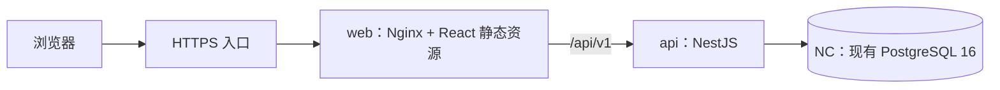

## Context

项目目前只有 `MarkSpace-V3-直接预览.html`、`MarkSpace-V3-配套建设方案.md` 和 OpenSpec 配置，没有应用工程、Git 仓库或远端配置。原型使用 HTML/CSS/JavaScript、浏览器存储和本地加密账号；其布局和交互可参考，认证与持久化需要重新实现。

用户已确定：单所有者 + 访客只读、PostgreSQL、NestJS 后端，复用 NC 上现有 PostgreSQL，以及通过 Git 平台自动构建 Docker 并推送平台镜像仓库。原方案中的 Spring Boot 选型由 NestJS 取代。前端沿用方案的 React + TypeScript + Vite。

用户补充确认产品名为 Linkora，仓库为 `https://github.com/assast/Linkora`；界面提供仓库跳转，本地 Git 设置对应远端，并在 `skill/` 提供管理服务的配套技能。

以下属于本提案的默认取舍，而非用户已逐项确认的要求：Prisma、永久删除、一期从空数据库启动。它们均有明确替代方向和调整边界。

## Goals / Non-Goals

**Goals:**

- 将 V3 三类页面实现为调用真实 API 的响应式前端，保留紧凑信息密度。
- 建立真实会话、统一服务端权限、多级分类、书签查询与事务式批量操作。
- 通过 PostgreSQL 支持重启后持久化、多设备访问以及标准数据库备份恢复。
- 提供同版本前后端镜像、自动化检查、Compose 部署与可复现的发布流程。

**Non-Goals:**

- 多用户注册、团队协作、独立私密空间、二次解锁、端到端加密。
- 回收站、跨页全选、拖拽排序、浏览器 HTML 导入、V2/V3 数据迁移。
- 服务端网页/图标抓取、失效检测、浏览器扩展、AI 分类与独立搜索服务。
- 本次生成文档即创建远端仓库、发布镜像或部署服务器。

## Decisions

### 1. 单仓库维护两个应用，使用统一 TypeScript 工具链

采用 pnpm workspace：`apps/web` 为 React + Vite，`apps/api` 为 NestJS，部署文件放在 `deploy/`，流水线放在 `.github/workflows/`。使用 Node.js 24.22.2 LTS，并在工程、CI 和后端镜像中锁定一致版本；依赖提交锁文件。

前端使用 TanStack Query 管理服务端数据与身份作用域缓存，本地组件状态处理选择、弹层和表单。Tailwind CSS 与必要的 shadcn/ui 组件用于复现原型，不先建立通用设计系统。

后端按 Auth、Categories、Bookmarks、Batch、Home、Preferences 和 Database 模块划分。被多个入口调用的权限查询、内容事务和预览计算抽为共享业务服务；不建立尚无多个调用方的通用 CRUD 基类或共享包。

选择依据：前后端独立构建，同时方便统一检查与 API 协作。两个独立仓库会增加当前单所有者项目的版本协调工作；微服务不符合一期规模。

### 2. PostgreSQL + Prisma，分类使用邻接表

Prisma 负责模型、一般 CRUD、事务和版本化迁移；递归分类与授权查询使用参数化的 PostgreSQL 递归 CTE。选择 Prisma 是为了与 NestJS/TypeScript 集成及可追踪迁移；TypeORM 也可满足需求，但本项目没有必须沿用其实体/仓储体系的存量代码。只维护一套数据库访问路径。

| 实体 | 关键字段与约束 |
|---|---|
| `users` | UUID、唯一邮箱、密码哈希、创建时间、内容修订号 `content_revision`；数据库约束保证最多一个所有者 |
| `sessions` | 所有者、随机令牌的哈希、CSRF 校验信息、过期时间；支持服务端注销 |
| `categories` | UUID、`owner_id`、可空 `parent_id`、名称、显式 `is_private`、`sort_order`、时间戳 |
| `bookmarks` | UUID、`owner_id`、可空分类、标题、URL、简介、备注、显式私密、星标、访问次数与时间戳 |
| `tags` / `bookmark_tags` | 所有者范围的规范化标签唯一；书签与标签关系去重 |
| `user_preferences` | 所有者唯一；主题、搜索引擎、列表视图、展开分类 ID |

同一所有者、同一父级下分类名称唯一，根分类的 NULL 父级使用 PostgreSQL `NULLS NOT DISTINCT` 唯一约束实现，不能仅依赖应用查重。分类、书签和标签引用校验同一所有者归属。删除书签时删除标签关联，删除分类只允许空分类；一期不添加软删除字段。

索引覆盖所有者/父级、所有者/分类/创建时间、所有者/星标和标签关联。分类树暂不使用闭包表或物化路径，以保持修改父级的成本和模型复杂度可控。

### 3. 权限在查询前计算，显式标志与继承结果分离

分类有效私密为自身或任一祖先的显式私密；书签有效私密为自身显式私密或所属分类有效私密。未分类书签只根据自身标志判定。

数据库保存 `is_private`，API 另返回 `effectivePrivate` 与是否继承，表单不得把“继承导致勾选”的展示状态写回成书签自身的私密标志。将分类移出私密祖先后，应重新计算结果，同时保留所有显式标志。

统一的授权查询先限定站点所有者和当前身份，再执行搜索、筛选、计数、排序和分页。首页、分类后代计数、标签建议、详情、导出共用这条规则；访客标签列表必须来自可见书签的关联，不能返回完整标签字典。访客读取私密或不存在的 ID 均返回 404；未经认证的写入返回 401。

单所有者模式下，普通内容明确表示对访客公开。将来增加多用户时需要独立变更公开发布规则，不能直接复用这一含义。

### 4. 内容写入串行化，公开变化使用修订号确认

所有分类、书签及标签关系修改在事务中锁定唯一所有者行，再执行校验与写入，并增加 `content_revision`。单所有者负载下可以接受该串行化方式，它同时解决并发调整父级形成环、分类删除与移入书签竞争的问题。访问计数和显示偏好不增加内容修订号。

分类修改、书签修改和批量操作提供只读预览，返回内容修订号、受影响数量、将变为公开的分类/书签数量以及必要摘要。批量提交，以及会使已有内容从私密变公开的单项修改，携带预览修订号；公开变化另携带明确确认。后端在同一写事务内重新计算影响，修订号或范围变化返回 409，要求刷新预览。

预览和提交复用同一计算服务；预览在同一一致性读取事务中获取内容修订号和影响范围，不能修改内容修订号或业务数据，避免把旧影响结果与新修订号组合返回。新增普通内容在表单中明确标为“访客可见”，不需要对不存在的旧内容计算公开变化。删除操作按明确数量二次确认，一期确认后永久删除。

选择修订号而非永久保存每次预览或维护每行版本，是因为只有一个所有者，额外一个修订字段即可获得明确且可测试的失效规则。

### 5. 部署初始化所有者，使用 PostgreSQL 服务端会话

提供镜像内可执行的 `owner:init` 命令，读取部署时提供的初始邮箱和密码。未初始化则创建唯一所有者；已存在则明确拒绝覆盖。应用不开放注册 API，生产环境不写入演示账号或演示书签。

密码使用 Argon2id 哈希。会话采用密码学随机令牌，数据库只存令牌哈希；浏览器使用 HttpOnly Cookie，生产环境启用 Secure 和 SameSite=Lax，默认有效期 7 天且可配置。登录执行来源校验和限流；其他认证写操作校验会话及 `X-CSRF-Token`，默认同域访问，不开放任意来源的带凭据跨域请求。

`GET /auth/me` 返回所有者或访客身份，登录后返回会话所需的 CSRF 信息；退出删除服务端会话并清 Cookie。API 响应采用 `Cache-Control: no-store`。前端以访客/所有者划分查询缓存，退出时取消请求并清除私密数据、选择和表单；收到 401 或重新检查身份发现会话失效时执行同样清理，页面重新获焦时重新检查身份。

相比 JWT 存浏览器持久存储，服务端会话更便于立即注销；当前规模直接使用 PG 会话表，避免增加会话基础设施。

### 6. API 与查询契约

接口统一使用 `/api/v1`，NestJS DTO 完成输入校验，OpenAPI 描述请求与错误结构。所有权只从会话或固定站点配置取得，不接受客户端指定所有者。

| 接口 | 用途 |
|---|---|
| `GET /auth/me`、`POST /auth/login`、`POST /auth/logout` | 身份与会话 |
| `GET /categories/tree`、`POST /categories` | 授权分类树、新建 |
| `POST /categories/:id/preview`、`PATCH /categories/:id`、`DELETE /categories/:id` | 分类变更预览、修改、删除空分类 |
| `GET /bookmarks`、`GET /bookmarks/:id`、`POST /bookmarks` | 查询、详情、新建 |
| `POST /bookmarks/:id/preview`、`PATCH /bookmarks/:id`、`DELETE /bookmarks/:id` | 单项变更预览、编辑、确认后删除 |
| `POST /bookmarks/:id/visits` | 所有者点击记录，异步且不阻塞跳转 |
| `GET /tags` | 授权后的标签筛选选项 |
| `POST /bookmarks/batch/preview`、`POST /bookmarks/batch` | 批量预览与提交 |
| `POST /bookmarks/export` | 所有者导出明确选择的书签 |
| `GET /home` | 常用、最近、授权统计 |
| `GET /preferences`、`PATCH /preferences` | 所有者偏好 |
| `GET /health` | 最小存活/数据库就绪状态，不返回敏感配置 |

列表参数包括 `categoryId`、`includeDescendants`（默认 true）、`keyword`、`tagIds`、`favorite`、有效私密筛选、`sort`、`page`、`pageSize`。默认每页 50、最多 100，返回 `items`、`total`、`page`、`pageSize`。先授权再分页；同一查询的列表和总数使用一致数据库快照。

关键词按字面子串匹配标题、URL、简介、备注、标签和分类路径，支持中文；多个标签采用全部匹配，分类、关键词、标签和属性条件取交集。排序支持新到旧、旧到新、名称和访问次数，使用 ID 补足稳定排序。初期使用 PG 参数化查询和现有索引，先以至少 5,000 条数据测量，不预设独立搜索服务。

标题最多 200 字符、分类名称 40 字符、单标签 40 字符，每书签最多 20 个标签；标签去空、去重、统一规范化键。URL 最多 4,096 字符，必须是有主机名的绝对 HTTP/HTTPS 地址；可保存内网地址，但服务端不请求该地址。简介最多 1,000 字符、备注最多 10,000 字符；这些上限由 DTO 与前端表单共同执行并写入 API 文档。

### 7. 批量操作只接受明确 ID 集合

一期前端只支持当前页全选，切换分页、排序、分类、查询或身份时清空选择。每次最多 100 个去重 ID；服务端仍独立校验每个 ID、目标分类和标签参数。

操作包括移动、添加/移除/替换标签、设置/取消星标、设置显式私密、删除。所有更新先完成整体校验，再在一个事务中应用；任一项目无效则整体失败。设置显式私密为 false 不取消继承效果，预览明确显示仍受祖先保护的数量。

JSON 导出先使用批量预览接口的 `EXPORT` 操作，再通过独立的已认证导出接口提交明确 ID 和有效预览修订号；包含私密内容时必须确认。导出在同一一致性快照中校验修订号并读取书签、标签和分类祖先，避免生成混合时刻的数据。文件包含 `formatVersion`、导出时间、选中书签、标签字符串以及必要分类祖先，保留显式私密标志。导出不包含会话、密码哈希或其他账号凭据，也不代表本次已实现导入。

相比跨页查询令牌和异步批处理，明确 ID + 数量上限 + 事务更贴合当前 MVP 和原型交互。

### 8. 三页面与视觉、偏好规则

视觉取 HTML 原型实际值：主色 `#7867E9`、背景 `#F7F8FC`、桌面侧栏 240px、列表行高约 49px，保留轻边框与紧凑间距。原方案中不同的示意色值不覆盖原型基准。

- `/home`：五种预定义搜索引擎；首页最多展示 10 个星标快捷入口，按所有者访问次数优先、稳定字段补排序；最近收藏取最新 7 项。空数据展示引导，不自动插入示例收藏。
- `/bookmarks`：分类树、紧凑列表/小卡片、组合筛选、排序、分页和当前页多选；私密条目与普通条目同树同列表，小锁仅作提示。
- `/bookmarks/new` 与 `/bookmarks/:id/edit`：共用表单与校验，保存后进入或保留编辑页并反馈成功，显示分类继承效果。预览使用首字母或本地图标，不触发外部抓取。
- 登录采用弹层；访客浏览保留完整的只读导航，管理动作先登录。
- 小于等于 720px 使用分类抽屉、隐藏次要列并保留搜索与批量入口；编辑预览在窄屏下收起。

外部搜索由前端用可信模板和 URL 编码构造，在新标签页打开；GitHub 默认仓库搜索。所有者偏好存 PG，访客只在本浏览器保存主题、引擎、视图和公开分类展开状态；登录后以账号偏好为准。访客点击不写入访问统计，所有者点击异步上报失败不影响打开网站。

运行界面、页面标题、登录与欢迎文案统一使用 Linkora。顶栏主题按钮旁添加指向 `https://github.com/assast/Linkora` 的“项目源码”文字链接，保留 GitHub 图标辅助识别，以 `noopener noreferrer` 在新标签页打开，移动端也保留文字。原始 MarkSpace HTML 与建设方案仍作为视觉来源保留。

### 9. 两个应用镜像连接 NC 现有 PostgreSQL

`web` 使用多阶段构建，将静态产物交给 Nginx，处理 SPA 路由回退并把 `/api` 转发至 `api`；`api` 使用 Node.js Debian slim 多阶段构建，包含运行产物、生产依赖以及迁移和初始化命令。数据库复用 NC 的 `ai-postgres`（PostgreSQL 16），应用使用专用账号和 `linkora` 数据库，测试使用独立账号和 `linkora_test` 数据库，不修改其他业务库。Compose 只运行 Web/API；数据库端口保持 NC 现有私有网络访问方式。Web 绑定 NC 私网地址 `10.144.144.10:8080`，同时加入现有 `proxy_network`，由 Traefik 按 `nav.icio.eu.org` 路由；正式认证来源为 HTTPS 域名，TLS 在 Cloudflare Tunnel 入口终止。

采用两个应用镜像是为了延续前后端独立构建和发布。把前端静态产物装入后端单镜像可减少一个服务，但会合并发布周期，本次选择前后端镜像配对发布。

Compose 使用已发布的 Web/API 同版本标签，而非要求服务器克隆源码后构建。确认 NC 数据库可连接后执行一次部署迁移，再启动 API 并检查就绪状态，最后提供 Web 入口。数据库连接与账号初始化值来自部署环境，保留脱敏示例配置；PG 备份和实际凭据不提交 Git 或打入镜像。

### 10. GitHub Actions + GHCR 发布

代码纳入 Git，提交锁文件、迁移和 Docker 构建文件。拉取请求运行 lint、类型检查、前后端测试、生产构建与镜像构建检查，不发布镜像。主分支检查成功后发布 `sha-<commit>` 与 `latest` 镜像；`vX.Y.Z` 标签通过相同检查后发布对应版本与 `latest`。

代码仓库为 `https://github.com/assast/Linkora`，本地 `origin` 指向该地址。镜像采用 `ghcr.io/assast/linkora-web` 和 `ghcr.io/assast/linkora-api`，两者记录相同提交与版本。发布使用工作流内置令牌及所需的 packages 写入权限；部署端仅需拉取权限。标签构建检出被标记的提交，并验证发布分支条件，避免发布错误源码。

CI 显式定义镜像目标平台，默认 `linux/amd64`；实际 ARM 主机需在接入发布前调整并验证目标平台。本地开发与验收使用 NC 的独立测试库；CI 启动隔离的 PostgreSQL 16 临时服务运行集成测试，保护递归查询和约束行为。暂不把服务器自动更新放入代码推送流程，发布后通过 Compose 拉取指定版本完成部署。

如果平台最终选择 GitLab 或 Gitea，保留 Dockerfile、Compose、测试和标签契约，只调整 CI 语法、凭据及镜像地址。

### 11. 验证围绕业务边界与实际部署

按用户最新指示，本地阶段直接运行前后端并连接 NC 专用 PG；Docker 引擎不在本机启动，镜像通过 Git 平台构建后再到 NC 验证。当前容器文件仅作为后续发布输入，实际发布和容器运行结果单独记录。

- API 单元/集成验证：四级分类与后代查询、防环和并发父级修改、空分类删除、私密继承、未知/私密 ID、访客写入拒绝、授权标签与总数、批量原子性及过期预览。
- 前端验证：表单继承状态、身份切换缓存清理、选择与分页范围、搜索引擎编码、偏好恢复及请求错误状态。
- 浏览器验收：桌面 1440×900、移动端 390×844；覆盖所有者与访客完整流程，并以原型对照布局、密度、主题和移动端抽屉；兼顾 Chromium 与 WebKit。
- 部署验收：空库迁移与初始化、两个镜像同版本拉取、应用重启及重连 NC PG 后数据仍在、备份恢复后分类与私密结果一致、前一应用版本回退验证。
- 搜索与分页使用至少 5,000 条混合私密数据验证，记录环境和结果；响应目标在实际服务器配置确定后量化。

### 12. 项目内 agent 管理技能

`skill/linkora-management/SKILL.md` 提供中文入口，按需读取 API 与运维参考。附带 Python 3 标准库客户端处理站点隔离的 0600 Cookie、可信 Origin、CSRF 和登录复用；凭据仅从环境或交互输入读取，不写入技能。客户端拒绝外部 API 路径与重定向，默认所有者请求不静默降为访客，访客检查显式选择匿名模式。

业务操作复用现有 API，不绕过预览、修订号、事务与继承私密规则。实际写入和导出用 `--apply` 表明执行意图，业务确认仍以用户已授权范围和服务端字段为准。运维沿用 NC 共享 PG 与配对镜像流程，不因加载技能自动发布、重置数据库或操作其他服务。

## Risks / Trade-offs

- [普通内容向访客公开] → 表单与预览明确标识，私密到公开的变化由后端要求确认，搜索和统计先过滤权限。
- [祖先修改影响大量后代] → 统一递归查询、所有者行锁、修订号预览和事务；不给派生私密状态建立另一套可漂移的存储。
- [永久删除无法撤销] → 显示数量并二次确认，提供 JSON 导出及数据库备份步骤；回收站通过后续变更引入。
- [内容写入串行化降低吞吐] → 适用于当前单所有者规模；多用户或高并发前重新评估锁粒度。
- [预览期间其他内容被修改] → 返回 409 并重新确认，代价是偶尔需要再次预览。
- [镜像可见性与主机架构未确定] → GitHub 仓库已确认，正式发布前核对 GHCR 权限及目标架构并执行真实拉取验收。
- [应用回退与数据库迁移不兼容] → 发布前备份，优先可向后兼容的增量迁移；不把替换旧镜像等同于数据库自动回滚。

## Migration Plan

1. 实施时建立 Git 工程、前后端应用、迁移与测试；本次仅创建 OpenSpec 文档。
2. 在 NC 专用的空 PG 数据库执行版本化迁移，通过部署命令初始化唯一所有者，验证无开放注册和默认密码。
3. 运行 API、浏览器及本地容器验收；保留原 HTML/方案，不读取或覆盖浏览器旧数据。
4. 确认目标代码仓库、镜像仓库可见性、服务器架构与 HTTPS 入口，配置 CI 并验证一次镜像发布与拉取。
5. 生产部署指定同版本的 Web/API 镜像，迁移成功后启动；保存数据库备份和前一镜像版本。
6. 回退时使用兼容当前数据库的上一应用镜像；若必须回退数据结构，先停止写入，按已验证的数据库备份恢复步骤执行。

## Open Questions

- GitHub 仓库已确认；GHCR 镜像的公开/私有范围仍需在实际发布时核对。
- NC 使用 amd64，生产主机地址为 `10.144.144.10`，域名为 `nav.icio.eu.org`；部署时通过现有 Traefik/Cloudflare Tunnel 核对域名公开路由。
- 若用户需要一期回收站或确有需迁移的 V3 数据，应在实施相应模块前调整规格；当前基线是确认后永久删除和空库启动。
